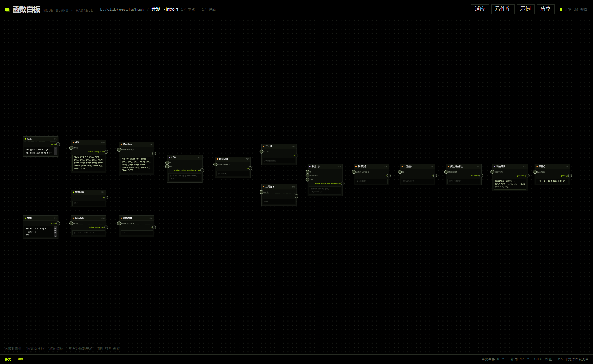
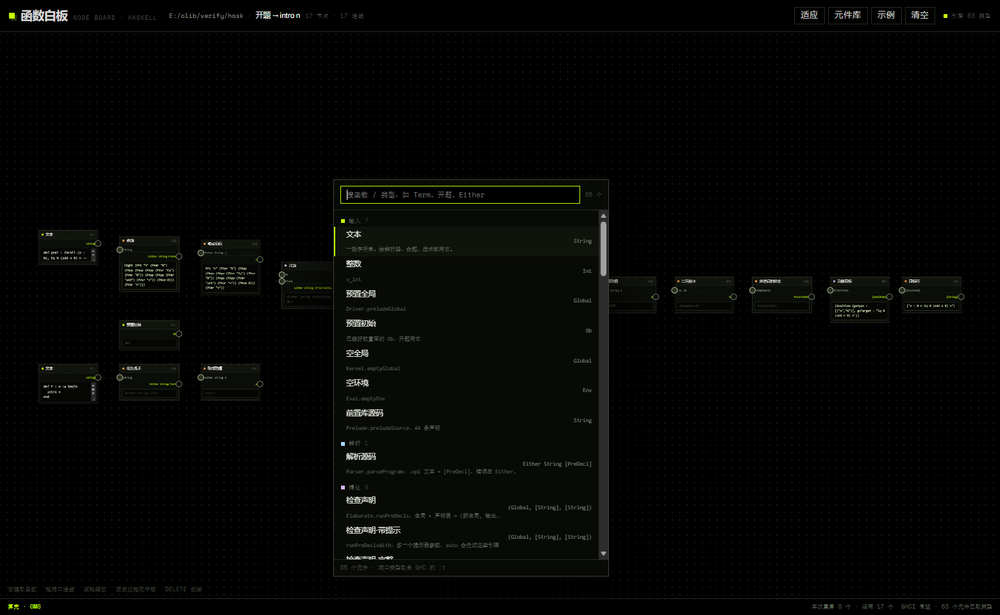

# 函数白板 · 教程

> 这份教程从"双击"讲到"给它加一个新函数"。跟着做一遍大约 15 分钟。
> 界面里按 `?` 也有一份一分钟版。

---

## 1. 打开

双击 `函数白板.cmd`。会开一个黑窗口，先打印体检表：

```
函数白板 · 体检
  Python   3.8.10  (C:\Users\你\AppData\Local\Programs\Python\Python38\python.exe)
  GHC      9.10.3  (C:\ghcup\bin\ghc.exe)
  工程     E:\olib\verify\hask  [ok]
  运行时   E:\wbws\hask_nodes\rt\BoardRt.hs  [ok]
  端口     8771  空闲
  结论     可以启动

  浏览器窗口马上打开；关掉这个黑窗口即停止引擎。
[白板] 引擎 就绪 · 63 个元件有类型 · 1435ms
```

三行要读懂：

- **Python** 只是用来起本地服务、读写画布文件，不参与计算。
- **GHC** 才是真正的计算引擎。没有它，白板能开、能摆节点，但连线不出值。
- **端口 8771** 是本地回环，不对外。重复双击会复用同一个实例，不会开第二个。

窗口打开后，画布上是"开题 → intro n"那张示例图。



---

## 2. 画布上有什么

```
┌─────────────────────────────────────────────────────────────┐
│ 函数白板  E:\olib\verify\hask / 开题 → intro n   适应 元件库 示例 清空 ? │
├─────────────────────────────────────────────────────────────┤
│                                                             │
│   ┌──────────────┐        ┌──────────────┐                  │
│   │ ● 命题   解析 │        │ ● 显示  打印  │                  │
│   │○ String      │───────▶│○ PTerm       │                  │
│   │  Either…  ●  │        │  String   ●  │                  │
│   │ [结果]        │        │ [结果]        │                  │
│   └──────────────┘        └──────────────┘                  │
│                                                             │
├─────────────────────────────────────────────────────────────┤
│ 算完 · 43ms                        本次重算 9 个 · 沿用 8 个   │
└─────────────────────────────────────────────────────────────┘
```

一个节点由四部分组成：

| 部位 | 含义 |
|---|---|
| 标题栏（彩色方块 + 名字） | 元件的类别与显示名；悬停看它来自哪个函数（如 `Opl.Kernel.findDef`） |
| 左侧圆点 + 类型文字 | **输入端口**，一个一个往下排，顺序和函数签名一致 |
| 右侧圆点 + 类型文字 | **输出端口**，只有一个 |
| 下方灰框 | 运行时算出来的值，或者错误 |

---

## 3. 取第一个节点

在空白处**右键**：



元件库按类别分组——解析 / 精化 / 内核 / 求值 / 打印 / 数学 / 语法 / 驱动 / JSON / 适配。
顶部可以搜：搜中文名、搜类型（`Term`、`Either`）、搜函数名都行。

试一次：

1. 右键空白 → 输入 `文本` → 回车。
2. 画布上出现一个「文本」节点，里面是一段示例字符串 `def two : N := Succ (Succ Zero)`。
3. 把框里的字改掉，比如 `def goal : forall (n : N), Eq N n n := id`。

**没有连线的节点也会立刻算**：它只依赖自己，所以改完马上就有值（这里是 `String`，值就是那串字本身）。

---

## 4. 连线：类型决定能不能接

从右边圆点按住，拖到另一个节点左边的圆点。

- 拖动时，**能接的端口亮绿**，接不上的标红。
- 接错了会弹一句：`接不上：[String] 不是 String`。
- 一个输入只接一条线。再拖一条过来会**替换**原来的。
- 从输入端起拖，可以**把线摘下来**重接。
- 会绕成环的连接会被拒绝（不是怕死循环，是纯表达式没法这样算）。

规则很朴素：

```
String  →  String        ✅ 一样
String  →  [String]      ❌ 少一层
String  →  a             ✅ 对方是类型变量，什么都收
[Term]  →  [Term]        ✅
(a, b)  →  (String, Int) ✅ 元组按位比，a/b 是变量
Either String [PreDecl]  →  [PreDecl]   ❌
                           要先过「取成功值」这个适配节点
```

最后那条是最常踩的：工程里大量函数返回 `Either String X`，失败信息在左边。
想直接往下接，就中间插一个**「取成功值」**（适配类，函数 `fromOk`）：成功时把 `X` 递下去，失败时节点标红并显示原因。

---

## 5. 节点里那几行字怎么读

| 显示 | 意思 | 下一步 |
|---|---|---|
| `["n : N ⊢ Eq N (add n 0) n"]` | 正常值 | 可以直接接下游 |
| `⟨Ob⟩` / `⟨ProofState⟩` | 值存在，但**没有 Show 实例**，打印不出来 | 继续接；要看内容就用「显示」「目标行」这类节点 |
| `⟨3 项结果⟩` | 是个三元组 | 用「三元组·1/2/3」拆开 |
| 红字 `Couldn't match …` | GHC 报错 | 看它指的第几行；改上游的文本 |
| 红字 `上游失败：解析源码` | 别人挂了，不是它 | 往上游找 |

`⟨Ob⟩` 这种不是 bug。Haskell 的 `print` 需要 `Show` 实例，`Global`、`ProofState` 故意没给实例——
它们本来就该被后续函数消费，而不是打印。

---

## 6. 改一个字面量，看下游跟着变

现在找示例图里的「战术文本」节点（`def t : N := begin … end`），把 `intro n` 改成 `intro m`。

最右端「目标行」节点会从

```
["n : N ⊢ Eq N (add n 0) n"]
```

变成

```
["m : N ⊢ Eq N (add m 0) m"]
```

同时看底部状态栏：

```
算完 · 43ms                        本次重算 9 个 · 沿用 8 个
```

17 个节点里只有**下游 9 个**重算了。再点一下别处、什么都不改，它会变成 `本次重算 0 个`、`0ms`——
这就是"不需要全量编译"的实际含义：常驻 GHCi 里模块早就在内存里，改一个节点只是重发一条 `let`。

如果改成 `intro 42`（不是名字），`tactOf` 会失败，下游一串变成「上游失败」，最右端那行报
`解析失败：line 2: …`。**错要错在它该错的地方**，别自己去猜。

---

## 7. 两张示例图

顶栏「示例」里有两张，都是真的：

**证明：开题 → intro n**（17 节点）

```
命题文本 ─goalOf→ PTerm ─fromOk→ ┐
                                  ├─startProof→ (ProofState, Ob) ─拆包→ 状态 / Ob
预置初始 ────────────────────────┘
                                                          │
战术文本 ─tactOf→ Tact ─fromOk→ ────stepProof(Ob, 状态, 战术)──→ (Ob, StepResult)
                                                          │
                                              步进后的状态 ─proofFrontier→ [GoalView]
                                                          │
                                                   目标行 → ["n : N ⊢ …"]
```

关键在 `stepProof` 是"有状态"的：它要**上一步的 `Ob` 和新状态**。
所以图里把 `startProof` 的结果拆开，`Ob` 和 `ProofState` 分别往下接。这是纯表达式图模拟状态的唯一办法。

**编译：前置库自检**（12 节点）

```
前置库源码 ─parseProgram→ Either [PreDecl] ─取成功→ [PreDecl] ┐
                                                              ├─runPreDecls→ (全局, 消息, 错误)
空全局 ───────────────────────────────────────────────────────┘
                                                              ├─三元组·3→ 错误表 → 长度 = 0
                                                              └─三元组·1→ 全局 ─findDef "add"→ Maybe Term
                                                                                    ─取 Maybe→ Term ─打印→ forall (_ : Nat), …
```

这张图回答"这份前置库到底编得过吗"：错误表长度 0，消息 32 条，`add` 的类型是 `forall (_ : Nat), forall (_ : Nat), Nat`。

---

## 8. 撤销、保存、关掉

- **保存是自动的**：每次改动 0.7 秒后写进 `data/graph.json`，关页面之前也会再存一次。
- **撤销** `Ctrl+Z`，重做 `Ctrl+Shift+Z`。节点拖动、连线、删除、改字面量都能撤。
- 关掉黑窗口 → 引擎停；再双击 → 画布从 `data/graph.json` 恢复。
- 想重来：顶栏「示例」→ 选一张；或「清空」。

---

## 9. 给它加一个新元件（三步）

元件表是手写的，因为"哪些函数适合连线"需要判断。加一个只要三步。

假设你想把 `Opl.Eval.vApp`（`Env -> Int -> Value -> Value -> Either String Value`）接进来。

**第一步**，在 `rt/BoardRt.hs` 的求值那一段加一行别名：

```haskell
v_vApp = Ev.vApp
```

（前缀是习惯：`k_` 内核、`e_` 精化、`p_` 解析、`v_` 求值、`r_` 打印、`s_` 语法、`d_` 驱动、`m_` 数学、`j_` JSON。）

**第二步**，在 `palette.py` 的 `COMPS` 里加一项：

```python
dict(id="v_vApp", rt="v_vApp", cat="eval", label="应用值",
     desc="vApp：环境 + 层 + 函数值 + 参数值，部分应用"),
```

`rt` 必须等于第一步里的别名。**类型不要写**——端口类型是引擎启动时用 `:t` 从 GHC 那里取的。

**第三步**，重启引擎：点顶栏右边那个「引擎 63 类型」的标记。等它重新就绪，右键里就多了一项「应用值」，
四个输入端口上写着 `Env`、`Int`、`Value`、`Value`。

如果 `:t` 失败（名字拼错、函数没导出），那一项会被静默丢掉，`/api/boot` 里 `known: false`。
**能出现在元件库里的，一定是 GHC 认得的东西**——这是这张白板不说谎的地方。

> 想确认某个函数"值不值得接进来"：看它的类型里有没有 `IO`、`OplM`、`PM`、`PS`。
> 有的话它需要 monad 上下文，不能直接当元件（这就是 `Session` 只导出了 `handleRequest` 而没进库的原因）。

---

## 10. 换成你自己的工程

```
python server.py --root D:\path\to\your-project
```

要求：`ghc` 能在 `-isrc` 下直接编译这个工程（只依赖 boot 包，或已有包环境）。

换工程后要改两处：

1. `rt/BoardRt.hs` 里的 `import qualified` 和别名——指向你工程的模块与函数；
2. `palette.py` 里的 `COMPS` 与分类。

`server.py` 不用动。它只做三件事：扫描元件、转发求值、存画布。

---

## 11. 键盘

| 键 | 作用 |
|---|---|
| 右键 | 空白处 = 元件库；节点上 = 复制 / 禁用 / 删除 |
| `空格` | 元件库（在视口中央） |
| `?` | 一分钟帮助 |
| 滚轮 | 缩放（端口反向缩放，缩到 0.4 倍仍可点） |
| 空白拖动 | 平移 |
| `F` | 缩放到全部节点 |
| `Delete` | 删除选中的节点或连线 |
| `Ctrl+Z` / `Ctrl+Shift+Z` | 撤销 / 重做 |
| `Esc` | 关掉浮层；取消正在拖的线 |

---

## 12. 出问题了看这里

**双击黑窗口一闪而过 / 报 `'python' is not recognized`**
启动脚本按 `py -3` → `where python` → `%LOCALAPPDATA%\Programs\Python\Python3*` → `%USERPROFILE%\.workbuddy\...` → `C:\Python3*` 找 Python，
找不到会停下来告诉你。仍然报这个，说明在跑旧脚本，或者手动开：
`"…\python.exe" server.py --app`。

**窗口开着，但顶栏写「引擎失败」**
说明 Python 找到了、GHC 没有。在命令行敲 `ghc --numeric-version` 试试；不行就装 GHC（ghcup），
装完把 `C:\ghcup\bin` 加进 PATH，或者直接在 `start.cmd` 里把 `BOARD_GHC` 指向 `ghc.exe`。

**节点全是 `…`，状态栏一直「计算中」**
第一个节点要等引擎预热（约 1.5 秒），之后才有值。超过 10 秒还在转，点顶栏引擎标记重启一次。

**改了 `.hs`，白板没反应**
常驻 GHCi 里是**解释执行的那一份**。改完源码要点顶栏引擎标记重启，才会重新 `:load`。

**画布空白，但状态栏有数字**
按 `F` 适应一下，可能刚才平移出去了。

**端口连不上，明明是同一个类型**
看大小写和空格。`String` 和 `[Char]` 已经归一化成同一个；但 `Either String Term` 和 `Either String (Term)` 括号不同，会被判成不同。
把鼠标停端口上看完整类型。

---

## 13. 它帮不上忙的地方

- **不做类型推断**：不会替你补 `fromIntegral`、不会自动解包 `Either`。接不上就是接不上，它只告诉你是哪个类型不对。
- **一个输入一条线**：没有"多路合并"。要合并就显式加个节点。
- **没有状态机**：`stepProof` 这类函数靠手把新 `Ob` 传下去，图本身不会回滚，也不会记住"上一步"。
- **不是证明助手**：它跑的是 Haskell 的类型检查，`⊢` 那一行只是这个工程里 `GoalView` 的字符串。
- **元件表是人工的**：65 个不是"全部"，是"能连线的那些"。剩下的大多需要 monad 上下文。

白板的价值不在替你算，而在**让你看得见一条计算的形状**：类型从哪来到哪去，改一处会影响哪一段，错是错在哪一跳。
